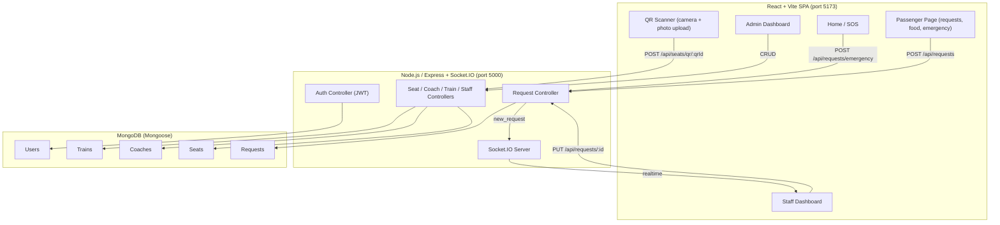
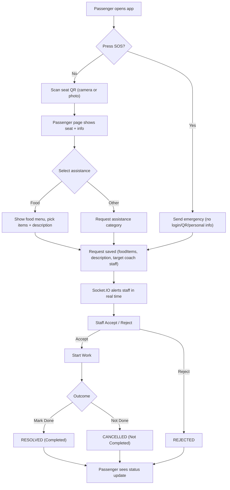

# RailAssist


## Table of Contents

- [Project Overview](#project-overview)
- [Features](#features)
- [Installation](#installation)
- [Quick Start](#quick-start)
- [Usage](#usage)
- [Architecture Diagram](#architecture-diagram)
- [Workflow Diagram](#workflow-diagram)
- [Configuration](#configuration)
- [Testing](#testing)
- [Contributing](#contributing)
- [License](#license)
- [Contact / Support](#contact--support)
- [Generated by AI](#generated-by-ai)

## Project Overview

RailAssist is a QR-based railway passenger assistance and emergency response system. It lets passengers scan a seat QR code with their camera to request onboard services — such as water, food, cleaning, or medical help — and receive real‑time responses from railway staff. The system is composed of a React + Vite frontend, a Node.js/Express REST API backed by MongoDB, and real‑time push notifications via Socket.IO.

A standout feature is the independent Emergency SOS flow: a passenger can trigger an emergency from the home page with **no login, no QR scan, and no personal information**, and the alert is routed to the nearest available onboard staff using whatever location data is available (a previously scanned seat or GPS). Staff and administrators get dedicated dashboards to manage requests, coaches, seats, staff-to-coach assignments, and QR code generation.

The project is built for rapid demonstration on a local machine: a seed script provisions a demo train (**Maland Express**), three sample passenger seats, and default admin/staff accounts, and a small script generates printable PDF QR codes for the sample passengers.

## Features

- **QR scanning** from the live camera or by uploading a photo containing a QR code.
- **Passenger assistance requests** — water, food, cleaning, general assistance, medical, security, lost child, and coach issues.
- **In-flight food ordering** — a menu is shown when FOOD is selected; the chosen items and any description are sent to the staff assigned to that coach.
- **Independent Emergency SOS** — works without login, QR, or personal data; silently sends a critical alert using a previously scanned seat or optional GPS.
- **Real-time staff notifications** via Socket.IO — requests appear instantly on the staff dashboard.
- **Staff dashboard** — accept/reject, start work, and mark requests Completed / Not Completed / Rejected, with a "My Coach" filter.
- **Admin dashboard** — manage trains, coaches, seats, staff, assign staff to coaches, and view system stats.
- **QR code generator** — admin-only page to view and generate seat QR codes.
- **Sample deliverables** — a seed script and a reproducible script that prints demo passenger QR PDFs.

## Installation

### Prerequisites

- **Node.js** >= 18 and npm
- **MongoDB** running locally (default connection: `mongodb://127.0.0.1:27017/railassist`)
- A browser with camera support for the QR scanning features

### Step 1 — Clone and install dependencies

```bash
git clone <YOUR_REPOSITORY_URL> railassist
cd railassist
```

Backend:

```bash
cd server
npm install
```

Frontend:

```bash
cd client
npm install
```

### Step 2 — Configure environment variables

Create a `server/.env` file (see [Configuration](#configuration) for the full list) at minimum with `MONGO_URI`, `JWT_SECRET`, and `PORT`.

### Step 3 — Seed the database

The seed wipes and re-creates demo data: the **Maland Express** train, two coaches (S1, S2), three sample passenger seats, and the default admin/staff accounts.

```bash
cd server
npm run seed
```
## Quick Start

After installing dependencies and seeding the database, run both servers:

Terminal 1 — backend:

```bash
cd server
npm run dev
```

Terminal 2 — frontend:

```bash
cd client
npm run dev
```

Then open **http://localhost:5173** in your browser.

### Demo accounts

| Role  | Email                  | Password   | Opens               |
|-------|------------------------|------------|---------------------|
| Admin | `admin@railassist.com` | `Admin@123`| `/admin/dashboard`  |
| Staff | `staff@railassist.com` | `Staff@123` | `/staff/dashboard`  |

To see a passenger flow, scan one of the sample QR codes (`sample-QR-Codes/` folder) with the camera on the **Scan QR** page, or open its passenger URL directly, e.g. `http://localhost:5173/passenger/16516-S1-01`.

## Usage

### Passenger flow

1. Go to the home page and press **Scan QR** (or press the **EMERGENCY SOS** button directly).
2. Point the camera at the seat QR code, or upload a photo of it.
3. The passenger page displays the name, age, seat, and **assistance options** (Water, Food, Cleaning, Assistance, Medical, Security, Lost Child, Coach Issue) plus an **EMERGENCY** button.
4. Choosing **Food** shows a menu; select items and optionally add a description, then submit.
5. Follow request status on the **Track your request status** page.

### Staff flow

1. Log in as a staff member.
2. Requests arrive instantly (Socket.IO). Use **Accept** / **Reject**, then **Start Work**, to finish with **Completed** / **Not Completed** / **Rejected**.
3. Use the **My Coach** filter to see only requests routed to you (based on your assigned coaches).

### Admin flow

1. Log in as an administrator.
2. Manage **Trains**, **Coaches**, **Seats**, **Staff**, and **Assign Staff** to coaches.
3. Generate/check seat QR codes in the **QR Generator** page.

### API endpoints (primary)

| Method | Endpoint                    | Description                                     |
|--------|-----------------------------|-------------------------------------------------|
| POST   | `/api/auth/login`           | Authenticate a user and return a JWT            |
| POST   | `/api/requests`             | Create a passenger assistance request           |
| POST   | `/api/requests/emergency`   | Create an independent emergency (SOS) request   |
| GET    | `/api/requests`             | List requests (optionally filtered by status/trainId/seatId/qrId) |
| PUT    | `/api/requests/:id`         | Update a request's status (auth required)       |
| GET    | `/api/seats/qr/:qrId`       | Resolve a seat from its QR code                 |
| GET    | `/api/trains`, `/api/coaches`, `/api/seats` | List resources                   |
| GET/POST/PUT/DELETE | `/api/staff`, `/api/coaches`, `/api/trains`, `/api/seats` | Admin CRUD        |

### Generate the sample QR PDFs

```bash
cd client
node scripts/generateSampleQr.cjs
```

The generated PDFs are written to `sample-QR-Codes/` (one per demo passenger: Aarav Sharma, Meera Iyer, Rohan Verma).
## Architecture Diagram



## Workflow Diagram



## Configuration

Environment variables for the backend live in `server/.env`:

| Variable     | Default                                    | Description                                        |
|--------------|--------------------------------------------|----------------------------------------------------|
| `PORT`       | `5000`                                     | HTTP server port                                   |
| `MONGO_URI`  | `mongodb://127.0.0.1:27017/railassist`     | MongoDB connection string                          |
| `JWT_SECRET` | *(required)*                               | Secret used to sign/verify JSON Web Tokens         |
| `CLIENT_URL` | `http://localhost:5173`                    | Allowed CORS origin                                |
| `NODE_ENV`   | `development`                              | Node environment                                   |

Frontend environment variables (optional, default to the local URLs):

| Variable          | Default                   | Description                    |
|-------------------|---------------------------|--------------------------------|
| `VITE_API_URL`    | `http://localhost:5000/api`| Backend REST base URL         |
| `VITE_SOCKET_URL` | `http://localhost:5000`    | Socket.IO server URL          |

The Vite dev server proxies `/api` and `/socket.io` to `http://localhost:5000`, so the frontend works out of the box during local development.
## Testing

The project does not include an automated unit/end-to-end test suite yet. Validation is currently done with the production build and backend syntax checks:

```bash
# Backend — syntax check source files
cd server
node --check src/server.js && node --check src/controllers/requestController.js

# Frontend — production build (validates all modules compile)
cd client
npm run build
```

To exercise the flows manually, run both servers, seed the database, and follow the [Usage](#usage) steps for passenger, staff, and admin. For camera/QR verification, open the **Scan QR** page and use either the live camera or the **Upload QR Photo** option.

## Contributing

Contributions are welcome. Please follow these steps:

1. **Fork** the repository and create a feature branch (`git checkout -b feature/my-change`).
2. Make changes and run the build/syntax checks above to ensure nothing is broken.
3. Keep the seed data and environment configuration documented if you change them.
4. Open a **Pull Request** with a clear description of the change and how to test it.

Focus areas that would improve the project: an automated test suite, an end-to-end QR-scan test, containerization (Docker/docker-compose), and HTTPS configuration for production camera/GPS access.

## License

This project is licensed under the **MIT License** (SPDX-License-Identifier: `MIT`).

You are free to use, modify, and distribute this software for educational and demonstration purposes. See the LICENSE file in the repository for the full terms.

## Contact / Support

- **Issue tracker:** open an issue in the repository's GitHub Issues page for bugs and feature requests.
- **Project scope:** this is a demonstration/prototype for a QR-based railway assistance system; for questions about setup, see the [Configuration](#configuration) and [Quick Start](#quick-start) sections.

## Generated by AI

Portions of this README and parts of the project's implementation were generated with the assistance of AI tooling. The documentation, diagrams, and code should be reviewed by a human maintainer before production use.